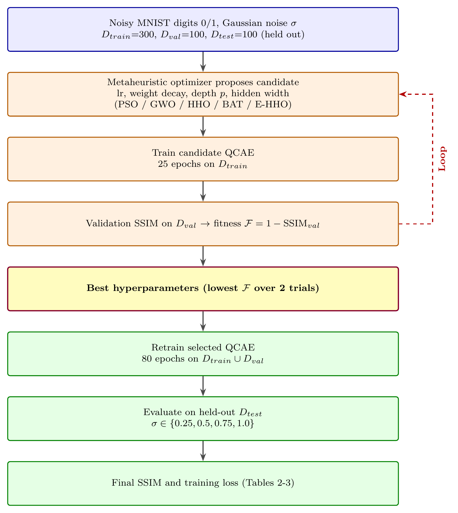
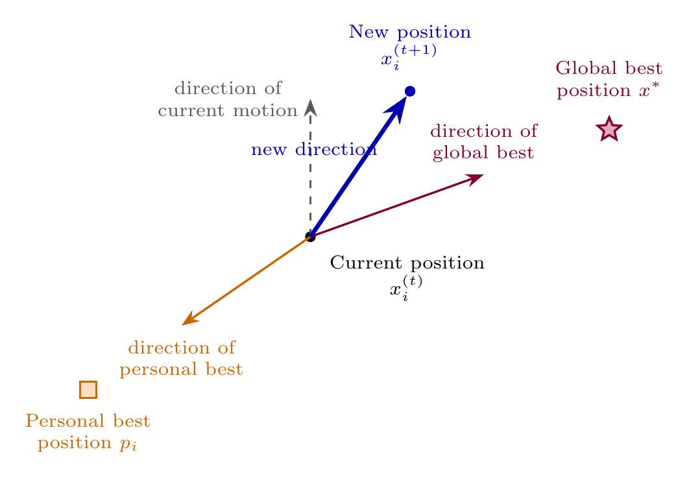
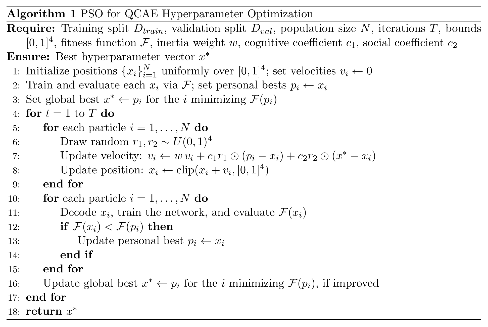
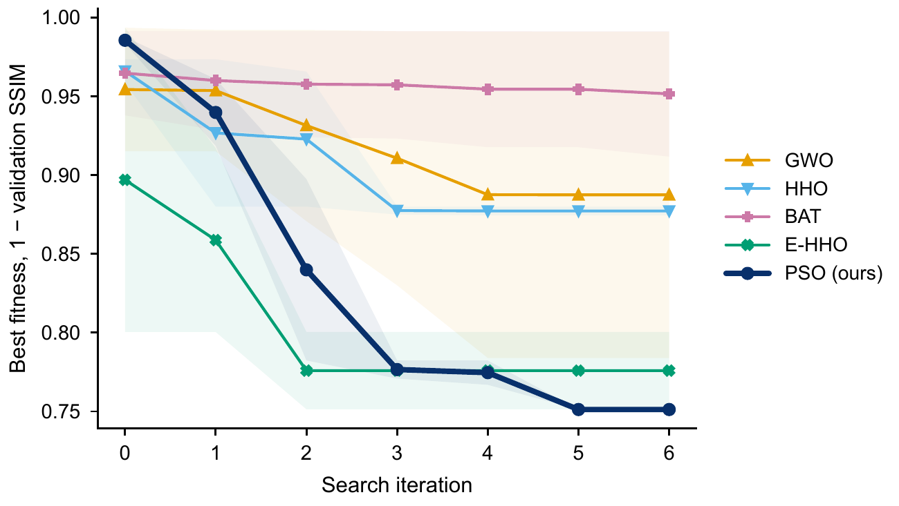
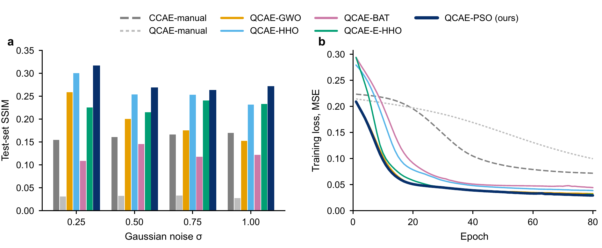
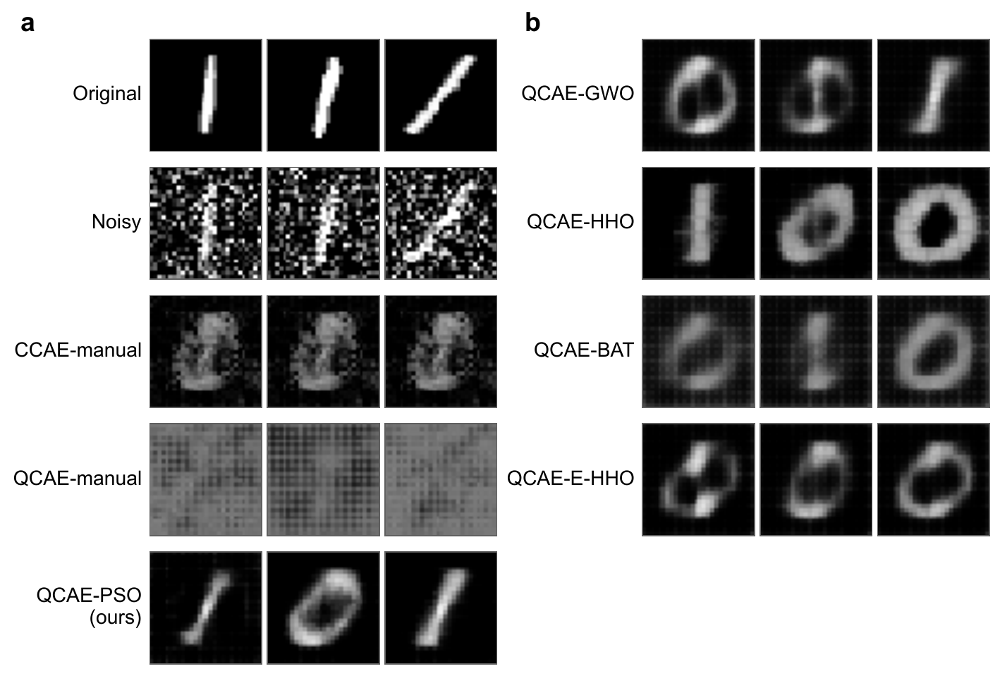
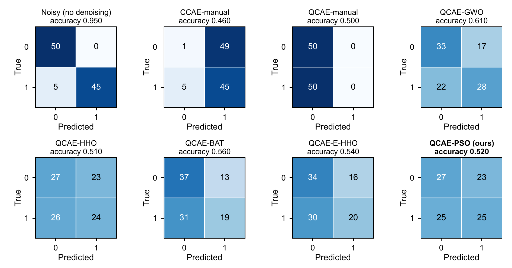
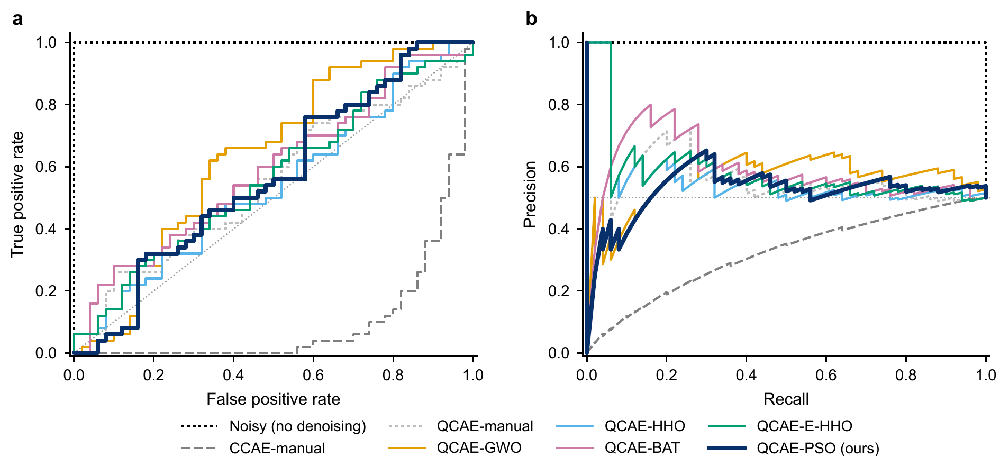

<div align="center">

# QCAE-PSO

### Metaheuristic-Optimized Quantum Convolutional Autoencoder for Image Noise Reduction

**Van Van Chau**<sup>1</sup> · **Hao Anh Nguyen**<sup>1</sup> · **Tuan Minh Nguyen**<sup>1,*</sup> · **Chinda Thorn**<sup>2</sup> · **Phayung Meesad**<sup>2,*</sup>

<sup>1</sup> Faculty of Information Technology, Posts and Telecommunications Institute of Technology, Ho Chi Minh City, Viet Nam<br>
<sup>2</sup> Department of Information Technology Management, King Mongkut's University of Technology North Bangkok, Bangkok, Thailand<br>
<sup>*</sup> Corresponding authors

*SN Computer Science*, manuscript SNCS-D-26-06066R1, accepted for publication, 2026

   

</div>

---

## Contents
[Abstract](#abstract) · [Contributions](#contributions) · [Evidence for every reported number](#evidence-for-every-reported-number) · [Method and protocol](#method-and-protocol) · [Results](#results) · [What the results show and what they do not](#what-the-results-show-and-what-they-do-not) · [Reproducibility notes](#reproducibility-notes) · [Reproducing the study](#reproducing-the-study) · [Repository layout](#repository-layout) · [Data and license](#data-and-license) · [Citation](#citation)

## Abstract
Residual noise degrades the visual quality of images and downstream machine learning tasks. Quantum Convolutional Autoencoders (QCAE) replace the latent space of a classical convolutional autoencoder with an ansatz circuit inspired by the Quantum Approximate Optimization algorithm (QAOA), yet their ansatz depth and training hyperparameters are still set by hand. Building on the QCAE of Kit et al., this study tunes them with Particle Swarm Optimization (PSO) and compares it with the grey wolf optimizer, the bat algorithm, plain Harris Hawks Optimization (HHO), and an enhanced HHO variant. The ansatz is reimplemented as a differentiable state vector layer, and all five optimizers search the same four-dimensional space on a reduced binary MNIST denoising benchmark under Gaussian noise. In the primary run, the PSO-searched QCAE achieved the highest mean test SSIM, about 72% above the classical baseline, and its configuration kept the highest mean SSIM over five retraining seeds. Across four full search repetitions, PSO, the grey wolf optimizer and the enhanced HHO variant reached nearly equal mean SSIM, while plain HHO and the bat algorithm were weaker and less stable. Among the searched configurations, however, the grey wolf optimizer gave the best downstream classification accuracy, precision, recall, F1-score and AUC and PSO led on none, although these differences lay within sampling error. An exploratory search with a wider learning-rate range raised the test SSIM of every optimizer by a factor of 1.7 to 3.6, so the search bounds matter at least as much as the choice of optimizer.

## Contributions
1. **PSO-based hyperparameter search for QCAE.** PSO searches the QAOA ansatz depth together with the learning rate, weight decay and hidden width, and is compared with four other optimizers under the same population size and number of iterations, over repeated searches and retraining seeds.
2. **Differentiable statevector ansatz.** The QAOA-inspired ansatz is simulated as an exact statevector in PyTorch, so gradients come from automatic differentiation instead of the parameter-shift rule. No quantum hardware is used.
3. **Controlled, fully traceable comparison.** A manually configured QCAE and a classical CAE are trained under the same protocol on a reduced binary MNIST benchmark at four noise levels. A seed-stability study, a search-space check and a downstream classification check accompany the main comparison, and every number in the paper is produced by the code and files in this repository.

<p align="center"></p>
<p align="center"><em><b>Figure 1.</b> System workflow. Blue: data preparation; orange: the search loop with its dashed return arrow; gold: the selected configuration; green: final retraining and the single held-out test evaluation.</em> <a href="figures/Fig1_workflow.pdf">[PDF]</a></p>

## Evidence for every reported number
Nothing in the paper was typed by hand from memory. Each table and each numerical statement can be traced to a file and checked with one command:

| What | Evidence in this repository | How to check |
|---|---|---|
| Tables 1–2, Figures 3–5 | `results/results.json`, written by `run_search.py`; console log `results/run_search.log` | `python verify_results.py` |
| Trained models of Table 2 | `results/checkpoints/model_*.pt`, the seven final models | `python evaluate_checkpoints.py` recomputes the test SSIM, largest difference from the stored values below 10<sup>−8</sup> |
| Table 7, Figures 6–7 | `results/classification_results.json` | `python classification_eval.py` rebuilds it from the checkpoints, byte-identical |
| Tables 4–6, robustness statements | `revision/results/*.json`, logs in `revision/logs/` | `python verify_results.py`; `python revision/aggregate.py` rebuilds `revision/results/summary.md`, byte-identical |
| McNemar test, QCAE-manual diagnosis | `revision/results/E4_mcnemar_pso_gwo.json`, `E3_diagnose.json`, `E3b_manual_longer.json` | `python revision/mcnemar_pso_gwo.py`, `python revision/run_revision.py diagnose`, byte-identical |
| Protocol of the robustness experiments | `revision/PROTOCOL.md`, fixed before the runs, with a dated addendum for the two post-hoc analyses | read |
| Integrity of the result files | `CHECKSUMS.sha256` | `shasum -a 256 -c CHECKSUMS.sha256` |

`verify_results.py` compares 271 values printed in the paper, every cell of Tables 1, 2, 4, 5, 6 and 7 and the numerical statements of the abstract and results text, with values recomputed from the JSON files at the precision printed in the paper. All 271 match; the full list is in [`results/verification_report.md`](results/verification_report.md). Two statements are not covered by a script: the reference values of Kit et al. in Table 3, read from that paper's figure, and the shrinking spread of the PSO population, which comes from a diagnostic run whose output was not saved.

## Method and protocol
- **Model.** A convolutional encoder compresses a 28×28 image to 4 values. Batch normalization and `tanh` map them to angles in [−π, π], angle-encoded on 4 qubits. A QAOA-inspired ansatz with `p` layers applies a ring of CNOT gates and trainable R<sub>Y</sub>/R<sub>Z</sub> rotations; the Pauli-Z expectations feed a mirrored convolutional decoder.
- **Baselines.** A classical CAE with the same encoder and decoder, and a QCAE with hand-set defaults: learning rate 0.001, depth 2, width 8.
- **Search space.** A vector in [0, 1]<sup>4</sup> decoded to a learning rate, log-uniform in [10<sup>−4</sup>, 10<sup>−2</sup>]; a weight decay, log-uniform in [10<sup>−6</sup>, 10<sup>−2</sup>]; a depth p ∈ {1, 2, 3}; and a hidden width ∈ {4, 8, 16}.
- **Fitness.** 1 − mean SSIM on the validation split after 25 epochs at σ = 0.5.

| Setting | Value |
|---|---|
| Data | MNIST digits 0 and 1; 300 training, 100 validation and 100 test images, fixed by seed 0 |
| Noise | Gaussian, σ = 0.5 during search and training; test at σ ∈ {0.25, 0.5, 0.75, 1.0} with fixed noise seeds |
| Search budget | population 6, 6 iterations, 2 independent trials per optimizer, same for all five |
| Final model | best configuration retrained for 80 epochs on training + validation images, seed 7, evaluated once on the test images |
| Test images | used only for the final evaluation, never during search or selection |

<p align="center"></p>
<p align="center"><em><b>Figure 2.</b> PSO velocity update, drawn in 2D: inertia, cognitive pull toward the personal best and social pull toward the global best.</em> <a href="figures/Fig2_pso_update.pdf">[PDF]</a></p>

<p align="center"></p>
<p align="center"><em><b>Algorithm 1.</b> PSO for QCAE hyperparameter optimization.</em> <a href="figures/Algorithm1_pso.pdf">[PDF]</a></p>

## Results
### Search, primary run
| Optimizer | Learning rate | Weight decay | Depth p | Width | Trial 1 | Trial 2 | Best fitness | Search cost, s |
|---|---:|---:|---:|---:|---:|---:|---:|---:|
| GWO | 0.0100 | 1.5e-04 | 2 | 16 | 0.9910 | 0.7839 | 0.7839 | 466 |
| HHO | 0.0100 | 9.2e-05 | 3 | 8 | 0.8800 | 0.8745 | 0.8745 | 379 |
| BAT | 0.0056 | 5.4e-04 | 3 | 16 | 0.9913 | 0.9118 | 0.9118 | 399 |
| E-HHO | 0.0100 | 9.8e-05 | 3 | 16 | 0.7514 | 0.8004 | 0.7514 | 353 |
| PSO (proposed) | 0.0100 | 1.0e-06 | 2 | 16 | 0.7512 | 0.7512 | 0.7512 | 573 |

<p align="center"></p>
<p align="center"><em><b>Figure 3.</b> Best fitness, 1 − validation SSIM, per iteration, mean of the two trials; the band spans the two trials.</em> <a href="figures/Fig3_search_convergence.pdf">[PDF]</a></p>

### Test SSIM of the final models, primary run
| Model | σ = 0.25 | σ = 0.5 | σ = 0.75 | σ = 1.0 | Mean SSIM | Training loss |
|---|---:|---:|---:|---:|---:|---:|
| CCAE-manual | 0.1545 | 0.1607 | 0.1662 | 0.1703 | 0.1629 | 0.0719 |
| QCAE-manual | 0.0310 | 0.0323 | 0.0329 | 0.0273 | 0.0309 | 0.0997 |
| QCAE-GWO | 0.2590 | 0.2004 | 0.1753 | 0.1528 | 0.1969 | 0.0327 |
| QCAE-HHO | 0.3002 | 0.2539 | 0.2530 | 0.2321 | 0.2598 | 0.0386 |
| QCAE-BAT | 0.1090 | 0.1458 | 0.1176 | 0.1219 | 0.1236 | 0.0443 |
| QCAE-E-HHO | 0.2258 | 0.2152 | 0.2410 | 0.2332 | 0.2288 | 0.0311 |
| QCAE-PSO (proposed) | 0.3167 | 0.2684 | 0.2627 | 0.2710 | 0.2797 | 0.0292 |

The PSO-searched QCAE has the highest mean test SSIM, 72% above the classical CAE. PSO also had the highest search cost, 44% above the mean of the other four optimizers.

<p align="center"></p>
<p align="center"><em><b>Figure 4.</b> (a) Test SSIM by noise level for the seven final configurations. (b) Training loss of the final retraining at σ = 0.5.</em> <a href="figures/Fig4_ssim_and_training.pdf">[PDF]</a></p>

<p align="center"></p>
<p align="center"><em><b>Figure 5.</b> Clean, noisy (σ = 0.5) and reconstructed images of the first three test digits for all seven configurations; the images were not selected.</em> <a href="figures/Fig5_denoising_examples.pdf">[PDF]</a></p>

### Is the primary result a lucky run? Five retraining seeds
The hyperparameters of Table 2 were held fixed and every configuration was retrained with five seeds; seed 7 is the published one. PSO scored above GWO in 5/5 seeds, above HHO in 5/5, above BAT in 5/5 and above E-HHO in 4/5.

| Configuration | Seed 7 | Seed 11 | Seed 23 | Seed 37 | Seed 53 | Mean ± SD |
|---|---:|---:|---:|---:|---:|---:|
| CCAE-manual | 0.1629 | 0.1506 | 0.1733 | 0.1487 | 0.1590 | 0.1589 ± 0.0099 |
| QCAE-manual | 0.0300 | 0.0198 | 0.0204 | 0.0274 | 0.0252 | 0.0246 ± 0.0044 |
| QCAE-GWO | 0.1956 | 0.2129 | 0.1980 | 0.1732 | 0.1919 | 0.1943 ± 0.0142 |
| QCAE-HHO | 0.2366 | 0.2266 | 0.1762 | 0.1843 | 0.2980 | 0.2243 ± 0.0488 |
| QCAE-BAT | 0.1344 | 0.1417 | 0.1350 | 0.1498 | 0.1518 | 0.1425 ± 0.0081 |
| QCAE-E-HHO | 0.2394 | 0.1873 | 0.2201 | 0.3748 | 0.2282 | 0.2500 ± 0.0724 |
| QCAE-PSO (proposed) | 0.2794 | 0.2771 | 0.2695 | 0.2931 | 0.3341 | 0.2907 ± 0.0257 |

### Four independent repetitions of the whole search
The search itself was repeated with three new seeds. Here PSO, GWO and E-HHO cannot be separated: their means lie within 0.006, far less than the run-to-run spread of each. In run 1 both PSO trials converged to a hidden width of 4.

| Optimizer | Run 0 (published) | Run 1 | Run 2 | Run 3 | Mean ± SD | Runs won |
|---|---:|---:|---:|---:|---:|---:|
| GWO | 0.1969 | 0.2189 | 0.3092 | 0.2630 | 0.2470 ± 0.0498 | 1 |
| HHO | 0.2598 | 0.1547 | 0.2208 | 0.0785 | 0.1784 ± 0.0795 | 0 |
| BAT | 0.1236 | 0.1895 | 0.1880 | 0.1762 | 0.1693 ± 0.0311 | 0 |
| E-HHO | 0.2288 | 0.2996 | 0.2460 | 0.2377 | 0.2530 ± 0.0318 | 1 |
| PSO (proposed) | 0.2797 | 0.1694 | 0.2741 | 0.2886 | 0.2529 ± 0.0560 | 2 |

### Widened search space, one exploratory run
Learning rate widened to [10<sup>−4</sup>, 10<sup>−1</sup>] and width to {4, 8, 16, 32, 64}; everything else unchanged. Every optimizer moved above the old learning-rate ceiling and gained a factor of 1.7 to 3.6, so the original bound was too narrow. This is a single run; repeated searches in the wide space are needed before its ranking carries the weight of the four-repetition comparison.

| Optimizer | Learning rate | Width | Depth p | σ = 0.25 | σ = 0.5 | σ = 0.75 | σ = 1.0 | Mean SSIM | Original space | Gain |
|---|---:|---:|---:|---:|---:|---:|---:|---:|---:|---:|
| GWO | 0.0582 | 32 | 2 | 0.4519 | 0.5047 | 0.4093 | 0.3749 | 0.4352 | 0.1969 | ×2.2 |
| HHO | 0.0226 | 32 | 3 | 0.5917 | 0.5608 | 0.3718 | 0.2274 | 0.4379 | 0.2598 | ×1.7 |
| BAT | 0.0372 | 16 | 3 | 0.5798 | 0.5175 | 0.4272 | 0.2616 | 0.4465 | 0.1236 | ×3.6 |
| E-HHO | 0.0788 | 8 | 3 | 0.5184 | 0.5046 | 0.4422 | 0.3516 | 0.4542 | 0.2288 | ×2.0 |
| PSO (proposed) | 0.1000 | 16 | 1 | 0.5751 | 0.6361 | 0.5946 | 0.5153 | 0.5803 | 0.2797 | ×2.1 |

### Downstream classification, σ = 0.5
A logistic regression trained on clean images classifies each reconstruction without retraining. QCAE-manual predicts only the negative class, so its precision and F1-score are undefined.

| Classifier input | Accuracy | Precision | Recall | F1-score | ROC-AUC | AP |
|---|---:|---:|---:|---:|---:|---:|
| Noisy (no denoising) | 0.950 | 1.000 | 0.900 | 0.947 | 1.000 | 1.000 |
| CCAE-manual | 0.460 | 0.479 | 0.900 | 0.625 | 0.099 | 0.327 |
| QCAE-manual | 0.500 | – | 0.000 | – | 0.553 | 0.584 |
| QCAE-GWO | 0.610 | 0.622 | 0.560 | 0.589 | 0.637 | 0.572 |
| QCAE-HHO | 0.510 | 0.511 | 0.480 | 0.495 | 0.541 | 0.568 |
| QCAE-BAT | 0.560 | 0.594 | 0.380 | 0.463 | 0.589 | 0.590 |
| QCAE-E-HHO | 0.540 | 0.556 | 0.400 | 0.465 | 0.562 | 0.585 |
| QCAE-PSO (proposed) | 0.520 | 0.521 | 0.500 | 0.510 | 0.564 | 0.530 |

Among the searched configurations GWO is best on accuracy, precision, recall, F1-score and ROC-AUC, BAT on average precision, and PSO on none. Every reconstruction is classified worse than the noisy input. With 100 test images these differences are within sampling error: an exact McNemar test of QCAE-PSO against QCAE-GWO gives p = 0.21, with 16 images correct only after PSO reconstruction and 25 only after GWO reconstruction.

<p align="center"></p>
<p align="center"><em><b>Figure 6.</b> Confusion matrices of the clean-trained classifier on the noisy test images and on each reconstruction at σ = 0.5.</em> <a href="figures/Fig6_confusion_matrices.pdf">[PDF]</a></p>

<p align="center"></p>
<p align="center"><em><b>Figure 7.</b> (a) ROC and (b) precision–recall curves of the clean-trained classifier at σ = 0.5. The dotted line is chance level.</em> <a href="figures/Fig7_roc_pr.pdf">[PDF]</a></p>

### Why QCAE-manual scores so low
Measured on the published checkpoints. Clean test images have a pixel SD across inputs of 0.175. QCAE-manual still varies with its input and its angles are not saturated, so it has not collapsed; its learning rate is too low for 80 full-batch updates. Retrained longer, its mean SSIM is 0.030 after 80 epochs, 0.085 after 200 epochs, 0.128 after 400 epochs.

| Configuration | Pixel SD across test inputs | Mean intensity | Angles with \|tanh\| > 0.99 |
|---|---:|---:|---:|
| CCAE-manual | 0.005 | 0.121 | no quantum layer |
| QCAE-manual | 0.061 | 0.326 | 0.75% |
| QCAE-GWO | 0.092 | 0.129 | 0.25% |
| QCAE-HHO | 0.097 | 0.122 | 3.00% |
| QCAE-BAT | 0.087 | 0.165 | 0.00% |
| QCAE-E-HHO | 0.111 | 0.132 | 0.50% |
| QCAE-PSO (proposed) | 0.126 | 0.121 | 0.50% |

## What the results show and what they do not
- **Shown.** Metaheuristic search improves QCAE over hand-set hyperparameters, and the PSO configuration keeps the highest mean SSIM under retraining.
- **Not shown.** PSO is not a better search procedure than GWO or E-HHO in this study: over four full repetitions the three are statistically indistinguishable, and PSO won two of the four runs.
- **Not shown.** PSO does not give the best downstream classification; GWO does on most metrics, within sampling error.
- **Bounds matter.** Widening the learning-rate range changed SSIM more than the choice of optimizer. The main tables keep the original space because the protocol fixed it before the experiments.
- **Scope.** Statevector simulation only, no hardware or shot noise; 500 MNIST images of two digits; four hyperparameters at a fixed qubit count.

## Reproducibility notes
- **Floating-point order.** QCAE training at learning rate 0.01 depends on the order of floating-point reductions, which changes with the number of CPU threads. Retraining with the published seed reproduced CCAE-manual, QCAE-manual, PSO and GWO within 0.002 SSIM, and E-HHO, BAT and HHO within 0.011 to 0.023. The checkpoints reproduce Tables 2 and 7 exactly; the multi-seed means are the more reliable estimate. All revision runs used two threads.
- **HHO implementation.** Plain HHO and E-HHO keep the exploration phase of Heidari et al. (2019) and replace the four besiege strategies, including the Lévy-flight dives, with the single move `x = x_rabbit − E·|J·x_rabbit − x|`.
- **Evaluation budget.** E-HHO's opposition step costs one evaluation per iteration, so E-HHO trains up to 48 configurations per trial against 42 for the others. GWO's code calls the fitness function 54 times per trial, but 12 of these calls re-read the already evaluated beta and delta leaders from the cache, so GWO also trains at most 42 configurations; `verify_results.py` checks this on the logged evaluations.
- **Fitness cache.** Fitness values are cached per configuration and shared across trials and optimizers. Because every candidate is trained with the same seed, a cached value is identical to a fresh one. In the three logged repetitions only one or two of about 380 distinct configurations per run had already been trained by another trial or optimizer, so the effect on the search costs is negligible.
- **Post-hoc analyses.** The longer retraining of QCAE-manual (E3b) and the McNemar test (E4) were added after the fixed protocol and are marked as such in `revision/PROTOCOL.md`. A first E3b run used one CPU thread; it was repeated with two threads like every other revision run and the superseded file is kept in `revision/results/superseded/`.

## Reproducing the study
Python 3.10 and the pinned packages:

```bash
pip install -r requirements.txt
```

Download the four MNIST idx files and place each one in a folder named after the file, or set `MNIST_DIR` to their location:

```
data/MNIST/train-images-idx3-ubyte/train-images-idx3-ubyte
data/MNIST/train-labels-idx1-ubyte/train-labels-idx1-ubyte
data/MNIST/t10k-images-idx3-ubyte/t10k-images-idx3-ubyte
data/MNIST/t10k-labels-idx1-ubyte/t10k-labels-idx1-ubyte
```

**Checks in seconds, no retraining**, from the repository root:

```bash
python verify_results.py         # 271 reported numbers against the JSON files
python evaluate_checkpoints.py   # Table 2 from the saved models
python classification_eval.py    # Table 7 from the saved models
python revision/aggregate.py     # revision/results/summary.md
```

**Full reruns:**

```bash
python run_search.py                                                   # primary run, about 40 minutes on an 8-core CPU
python revision/run_revision.py retrain_seeds --threads 2              # five retraining seeds, about 10 minutes
python revision/run_revision.py search --s 1 --space orig --threads 2  # search repetition, also s = 2 and 3, about 25 minutes each
python revision/run_revision.py search --s 0 --space wide --threads 2  # widened space, about 35 minutes
python revision/run_revision.py diagnose                               # QCAE-manual diagnosis, seconds
python revision/e3b_longer.py                                          # QCAE-manual retrained longer, a few minutes
python revision/mcnemar_pso_gwo.py                                     # McNemar test, seconds
```

`run_search.py` overwrites `results/results.json` and the checkpoints; because of the floating-point note above, a rerun on another machine can differ slightly from the published values.

| Script | Purpose |
|---|---|
| `models.py` | Classical CAE and QCAE with the statevector-simulated ansatz |
| `metaheuristics.py` | PSO, GWO, HHO, BAT and E-HHO, search-space decoder, fitness function |
| `data_utils.py` | Binary MNIST subset and Gaussian noise |
| `run_search.py` | Search, final retraining and test evaluation |
| `classification_eval.py` | Downstream classification metrics |
| `evaluate_checkpoints.py` | Test SSIM of the saved models |
| `verify_results.py` | Every reported number against the result files |
| `revision/run_revision.py` | Retraining seeds, search repetitions, widened space, QCAE-manual diagnosis |
| `revision/e3b_longer.py`, `revision/mcnemar_pso_gwo.py` | Longer QCAE-manual training, McNemar test |
| `revision/aggregate.py` | Summary of all robustness experiments |

## Repository layout
```
*.py                     model, optimizers, data, main experiment, checks
results/
  results.json                  search histories, selected hyperparameters, test SSIM, training curves
  classification_results.json   confusion matrices, ROC and precision-recall data
  run_search.log                console log of the run that produced results.json
  checkpoints/                  the seven trained final models
  verification_report.md        output of verify_results.py
revision/
  PROTOCOL.md                   protocol of the robustness experiments, fixed before the runs
  logs/, results/               console logs and result files of every robustness run
figures/                 figures of the paper, vector PDF; png/ holds 300-dpi copies shown on this page
CHECKSUMS.sha256         SHA-256 of every result, log and checkpoint file
```

## Data and license
The study uses the MNIST handwritten digit database of Y. LeCun, C. Cortes and C. J. C. Burges, available under CC BY-SA 3.0. The images are not redistributed here; `data_utils.py` selects the subset from the original files with a fixed seed. The code is released under the MIT License.

## Citation
The article is accepted in *SN Computer Science*. Until its DOI is available, please cite it as below or use `CITATION.cff`.

```bibtex
@article{chau2026qcaepso,
  title   = {Metaheuristic-Optimized Quantum Convolutional Autoencoder for Image Noise Reduction},
  author  = {Chau, Van Van and Nguyen, Hao Anh and Nguyen, Tuan Minh and Thorn, Chinda and Meesad, Phayung},
  journal = {SN Computer Science},
  year    = {2026},
  note    = {Accepted for publication}
}
```

## Contact
Corresponding authors: Tuan Minh Nguyen, Posts and Telecommunications Institute of Technology, minhtuan@ptit.edu.vn; Phayung Meesad, King Mongkut's University of Technology North Bangkok, phayung.m@itd.kmutnb.ac.th
